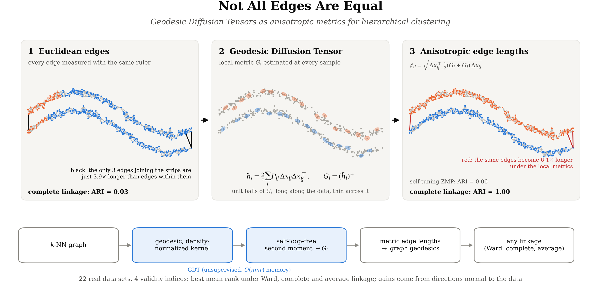

# Not All Edges Are Equal: Geodesic Diffusion Tensors as Anisotropic Metrics for Hierarchical Clustering

This repository contains the source code needed to reproduce every experiment, table and figure of the paper
*"Not All Edges Are Equal: Geodesic Diffusion Tensors as Anisotropic Metrics for Hierarchical Clustering"*.



**In a nutshell.** Hierarchical clustering on a $k$-NN graph usually measures every edge with the Euclidean
norm. We instead estimate a local metric tensor $G_i$ at every sample with the **Geodesic Diffusion Tensor (GDT)**.
GDT is the self-loop-free second moment of a density-normalized diffusion kernel supported on graph geodesics.
Each edge is then measured as

$$\ell_{ij} = \sqrt{\Delta x_{ij}^\top \tfrac12 (G_i + G_j)\, \Delta x_{ij}} .$$

Shortest paths under these lengths are passed unchanged to any linkage criterion (Ward, single, complete, average).

---

## Contents

```
gdt-hclust/
├── metric_tensor_spring.py            # core library: data loading/preprocessing, k-NN graphs, MST bridges,
│                                      #   classical MDS, geodesic kernel support, GDT in low dimension, plots
├── hierarchical_metric_clustering.py  # GDT in factored form (O(n m r) memory), edge metrics
│                                      #   (euclid, tangent, zmp, sigma, gdt, gdt_full), geodesics, linkages;
│                                      #   also a command-line tool for a single data set
├── benchmark_hclust.py                # the benchmark of the paper (22 data sets x 5 edge metrics x 3 linkages)
├── analysis/
│   ├── analyze_results.py             # Friedman, Wilcoxon-Holm, win/tie/loss, rank ablation, correlations, runtimes
│   ├── make_tables.py                 # LaTeX tables of the paper (main text + appendix)
│   ├── make_figures.py                # figures of the paper (CD diagrams, scatter plots, heatmaps, runtime)
│   └── graphical_abstract.py          # graphical abstract (two-strip synthetic example)
├── results/paper/benchmark_long.csv   # raw results reported in the paper (330 rows)
├── docs/graphical_abstract.png
├── requirements.txt
└── README.md
```

## 1. Installation

The code requires Python ≥ 3.9 and only standard scientific packages.

```bash
git clone https://github.com/alexandrelevada/gdt-hclust.git
cd gdt-hclust
python -m venv .venv
source .venv/bin/activate            # Windows: .venv\Scripts\activate
pip install -r requirements.txt
```

The results in the paper were obtained with Python 3.13, NumPy 2.5, SciPy 1.18, scikit-learn 1.9, pandas 3.0,
matplotlib 3.11 and NetworkX 3.7.

## 2. Quick start: one data set

```bash
# digits, all edge metrics, Ward/complete/average linkage, four validity indices
python hierarchical_metric_clustering.py --dataset digits --linkages ward complete average

# any OpenML data set, by name or by id
python hierarchical_metric_clustering.py --source openml --dataset satimage --weights euclid zmp gdt_full
python hierarchical_metric_clustering.py --source openml --data-id 61
```

The script prints one table per validity index (ARI, AMI, FMI, V-measure) and writes CSV files, LaTeX tables
and a bar chart named `hclust_<source>_<dataset>_*`. Run `python hierarchical_metric_clustering.py -h` for all options.

### Using GDT in your own code

```python
import numpy as np
from sklearn.datasets import load_digits
from sklearn.preprocessing import StandardScaler
from sklearn.metrics import adjusted_rand_score
import metric_tensor_spring as MT
import hierarchical_metric_clustering as H

X, y = load_digits(return_X_y=True)
X = StandardScaler().fit_transform(X[:, X.std(0) > 0])
n, m = X.shape

A = MT.knn_graph(X, 15, 'distance')                       # symmetric 15-NN graph
A, _ = MT.mst_bridges(X, A)                               # connect components, if any
A = A.tocoo(); i, j = A.row, A.col

U, c = H.gdt_lowrank(X, d=m, verbose=False)               # GDT_m: full-rank local metrics, G_i = U_i diag(c_i) U_i^T
lengths = H.edge_lengths(X, i, j, U, c)                   # l_ij = sqrt(dx^T (G_i + G_j)/2 dx)
D = H.geodesics(A, lengths)                               # all-pairs graph geodesics
labels = H.cluster(D, 'average', c=10, mds_dims=10)       # 'ward', 'single', 'complete' or 'average'
print('ARI =', round(adjusted_rand_score(y, labels), 3))  # 0.708, as in the paper
```

Use `d = <intrinsic dimension>` instead of `d = m` for the rank-restricted variant GDT<sub>d</sub>. Use
`H.zmp_lengths(X, i, j, k_zmp=7)` for the self-tuning baseline of Zelnik-Manor & Perona.

## 3. Reproducing the experiments of the paper

### Step 1: run the benchmark

```bash
python benchmark_hclust.py --out results/benchmark
```

The defaults are exactly the settings of the paper:

| Setting | Value |
|---|---|
| Data sets | the 22 data sets of the paper; `iris` and `digits` come from scikit-learn, the others are fetched from OpenML by name |
| Preprocessing | one-hot encoding, median imputation, removal of constant columns, z-score, PCA to 50 components when m > 100, stratified subsampling to at most 10,000 samples, removal of exact duplicates |
| Edge metrics | `euclid`, `tangent`, `zmp`, `gdt` (GDT<sub>d</sub>), `gdt_full` (GDT<sub>m</sub>, computed when m ≤ 100) |
| Linkages | Ward (on classical MDS of the geodesics, max(10, d̂) dimensions), complete, average |
| Graph and kernel | k = 15 (geodesic graph and local PCA), k_g = 10 (kernel support), k_ε = 15 (bandwidth), k_s = 10 (smoothing), c_ε = 1, τ₀ = 10⁻² |
| ZMP | σ_i = distance to the 7th nearest neighbor |
| Intrinsic dimension | Levina–Bickel with k = 15, capped at 10 |
| Seed | 0 (single stratified subsample per data set) |

Outputs, written to `results/` with the prefix given by `--out`:

| File | Content |
|---|---|
| `benchmark_long.csv` | one row per (data set, edge metric, linkage) with ARI, AMI, FMI, V-measure, d̂ and timings |
| `benchmark_<M>_wide.csv` | one table per index M ∈ {ARI, AMI, FMI, Vmeasure} |
| `benchmark_<M>_table.tex`, `benchmark_tables.tex` | LaTeX tables with the best metric per linkage in bold |
| `benchmark_summary.txt` | the same tables in plain text |
| `benchmark_errors.txt` | data sets that could not be processed, if any |

**Practical notes**

* **Run time and memory.** The full benchmark takes roughly half an hour to one hour on a recent desktop.
  The largest data sets (n ≈ 10,000) need dense n × n geodesic matrices, so plan for at least 8 GB of RAM;
  16 GB is comfortable. Reduce `--max-samples` (for example to 3000) for a quicker run.
* **Interrupted runs.** Add `--resume` to continue from an existing `benchmark_long.csv`. Data sets that are
  already finished are skipped. If you add a new edge metric to the list, only the missing metric is computed.
* **OpenML.** The first run downloads the data sets from OpenML and caches them in `~/scikit_learn_data`. Later
  runs work offline. OpenML data sets are fetched in their *active* version, so a future change on OpenML may
  slightly alter a result. `--openml-id NAME=ID` pins a specific id, and `--local NAME=file.npz` (arrays `X`
  and `y`) or `--local NAME=file.csv` (label in the last column) uses a local copy.
* **Subsets and speed.** `--datasets iris digits seeds` runs a subset, `--linkages ward complete average single`
  adds single linkage, and `--max-support 200` bounds the kernel support per point. The last option makes GDT
  faster on large data but changes the results slightly; it was *not* used in the paper.

### Step 2: statistical analysis

```bash
mkdir -p outputs
python analysis/analyze_results.py --input results/benchmark_long.csv > outputs/analysis.txt
```

The script reports, for each index and linkage:

* the Friedman test and the mean ranks;
* win/tie/loss counts, median and mean paired differences, and Wilcoxon signed-rank tests with Holm correction
  for GDT<sub>m</sub> and GDT<sub>d</sub> against each baseline;
* the rank ablation (GDT<sub>m</sub> vs. GDT<sub>d</sub>);
* the Spearman correlations between the gains and the characteristics of the data sets;
* the run times.

### Step 3: tables and figures

```bash
python analysis/make_tables.py  --input results/benchmark_long.csv --outdir outputs
python analysis/make_figures.py --input results/benchmark_long.csv --outdir outputs
python analysis/graphical_abstract.py                     # writes outputs/graphical_abstract.{pdf,png}
```

| Output | Item in the paper |
|---|---|
| `outputs/tab_summary.tex` | Table: mean score and mean rank per index and linkage, with Friedman p-values |
| `outputs/tab_wilcoxon.tex` | Table: pairwise Wilcoxon–Holm comparisons of GDT<sub>m</sub> with each competitor |
| `outputs/appendix_tables.tex` | Appendix: description of the data sets and full results for the four indices |
| `outputs/figs/cd_ARI.pdf` (`cd_AMI.pdf`) | Figure: critical difference diagrams (Nemenyi, α = 0.05) |
| `outputs/figs/scatter_ARI.pdf` | Figure: per-data-set ARI of GDT<sub>m</sub> against each baseline |
| `outputs/figs/heatmap_gain_ARI_combined.pdf` | Figure: ARI gain over the Euclidean metric and over the best baseline |
| `outputs/figs/runtime.pdf` | Figure: run time of the edge-metric estimation and of the clustering |
| `outputs/graphical_abstract.pdf` | Graphical abstract |

The tables need `\usepackage{booktabs,graphicx}` in the LaTeX preamble.

### Reproducing the tables and figures without rerunning the benchmark

The raw results of the paper are in `results/paper/benchmark_long.csv`. They are also the default input of the
analysis scripts, so the following commands regenerate every table and figure of the paper in a few seconds:

```bash
mkdir -p outputs
python analysis/analyze_results.py > outputs/analysis.txt
python analysis/make_tables.py
python analysis/make_figures.py
```

## 4. The 22 data sets

| Data set | n | m | m used | d̂ (used) | classes |
|---|---:|---:|---:|---:|---:|
| iris | 149 | 4 | 4 | 2.65 (3) | 3 |
| penguins | 344 | 6 | 10 | 3.08 (3) | 3 |
| user-knowledge | 403 | 5 | 5 | 4.27 (4) | 5 |
| seeds | 210 | 7 | 7 | 3.38 (3) | 3 |
| digits | 1797 | 64 | 61 | 7.27 (7) | 10 |
| mfeat-zernike | 1994 | 47 | 47 | 4.31 (4) | 10 |
| mfeat-karhunen | 1994 | 64 | 64 | 10.84 (10) | 10 |
| mfeat-fourier | 1994 | 76 | 76 | 10.01 (10) | 10 |
| mfeat-factors | 1994 | 216 | 50 | 6.93 (7) | 10 |
| semeion | 1593 | 256 | 50 | 8.45 (8) | 10 |
| pendigits | 10000 | 16 | 16 | 5.36 (5) | 10 |
| coil-20 | 1440 | 1024 | 50 | 2.46 (2) | 20 |
| Olivetti_Faces | 400 | 4096 | 50 | 4.72 (5) | 40 |
| USPS | 9298 | 256 | 50 | 8.12 (8) | 10 |
| artificial-characters | 4861 | 7 | 7 | 2.71 (3) | 10 |
| satimage | 6430 | 36 | 36 | 9.79 (10) | 6 |
| texture | 5473 | 40 | 40 | 5.59 (6) | 11 |
| UMIST_Faces_Cropped | 565 | 10304 | 50 | 2.35 (2) | 20 |
| letter | 9604 | 16 | 16 | 4.85 (5) | 26 |
| waveform-5000 | 5000 | 40 | 40 | 23.16 (10) | 3 |
| isolet | 7797 | 617 | 50 | 11.22 (10) | 26 |
| Indian_pines | 9144 | 220 | 50 | 18.77 (10) | 8 |

Here n is the number of samples after subsampling (at most 10,000) and removal of exact duplicates. The column
"m used" gives the number of attributes after one-hot encoding and PCA.

## 5. Citation

If you use this code, please cite:

```bibtex
@article{levada2026gdt,
  author  = {Levada, Alexandre L. M.},
  title   = {Not All Edges Are Equal: Geodesic Diffusion Tensors as Anisotropic Metrics for Hierarchical Clustering},
  journal = {(under review)},
  year    = {2026}
}
```

## License

<!-- Choose a license (e.g., MIT or BSD-3-Clause) and add the corresponding LICENSE file. -->

## Contact

Alexandre L. M. Levada, Departamento de Computação, Universidade Federal de São Carlos (UFSCar), Brazil.
